# Smart Epoxy Curing Station — firmware

Firmware for the co-operative education project *Design and Development of a Smart Epoxy Curing Station
for Endoscope Repair* (Phatcharapon Putyuen, Biomedical Engineering, KMITL), built for the Biomedical
Engineering (BME) Department of FUJIFILM (Thailand) Ltd.

The station replaces an STC-1000 thermostat and kitchen timers on the bench where endoscope parts are
glued. It holds a heated box at a set temperature (40–50 °C, 47 °C in use) and times up to six cures at
once, each with its own user and alarm tone. It shows everything on a 4.0-inch touch screen, and the
alarm can be stopped from across the room with a wireless button.

This repository is an Arduino library (`EpoxyCuringStation`). The shared modules are in `src/` and the
sketches are in `examples/`. **The station runs `examples/Test_ui_fuji`.**

## Screens

Pictures from the UI design mock-up (480 × 320, the same size as the panel). The firmware in
`src/ui_fuji.cpp` draws the same layouts. Users are shown as User A–D.

| | |
|---|---|
| 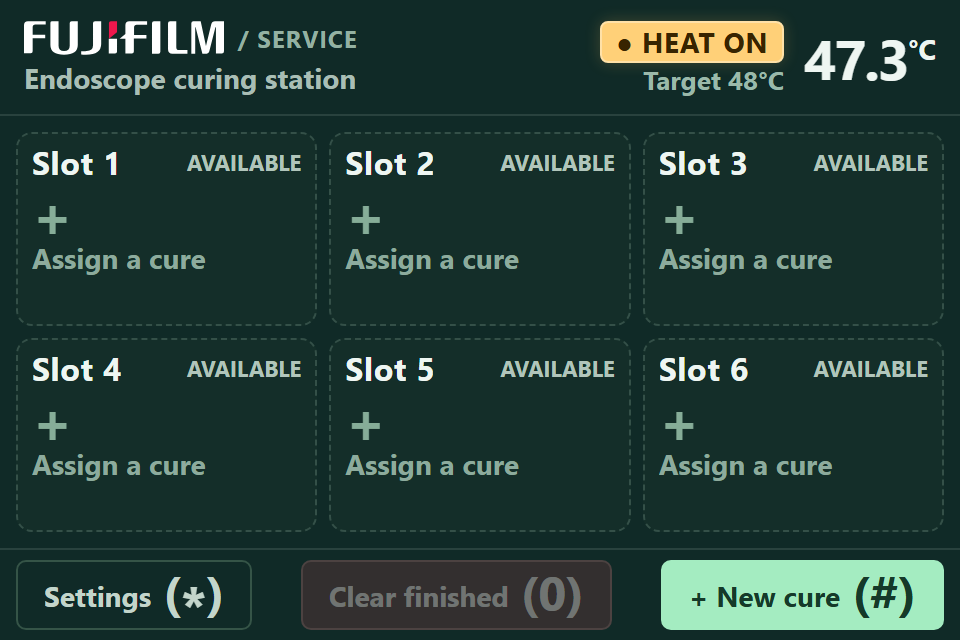<br>Home: six slots, temperature and heater state | 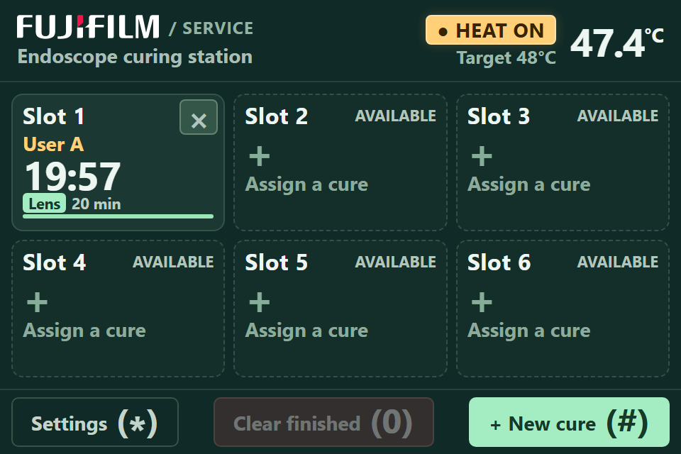<br>Home with one cure running |
| 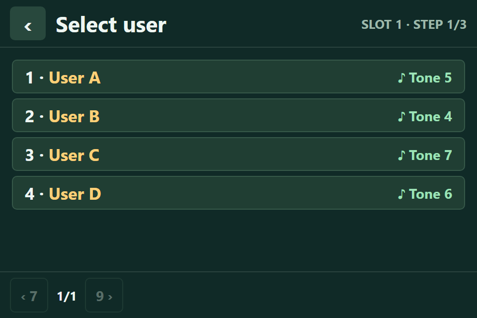<br>Start a cure, step 1: pick the user | 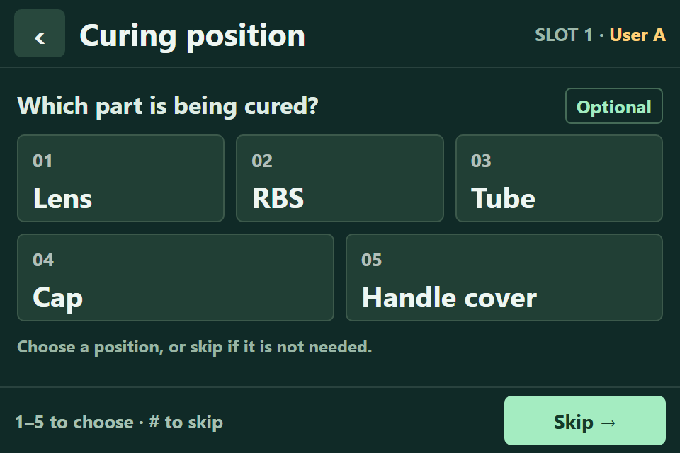<br>Step 2 (optional): the part being cured |
| 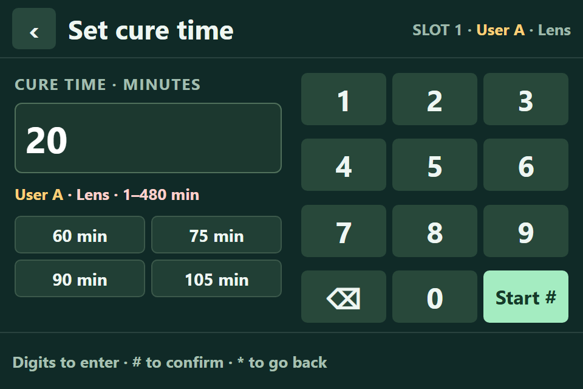<br>Step 3: cure time in minutes | 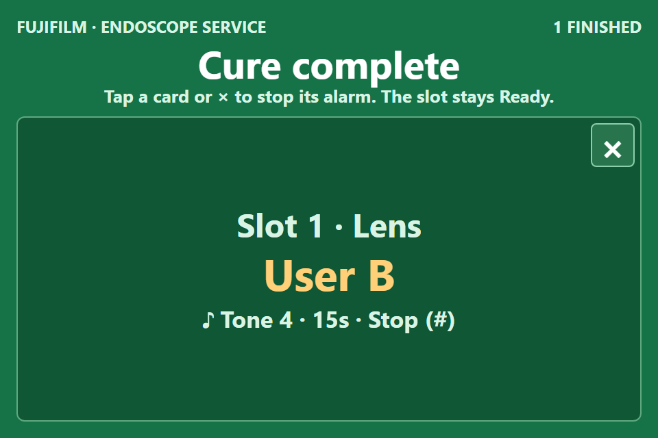<br>Cure complete: the alarm plays the user's tone |
| 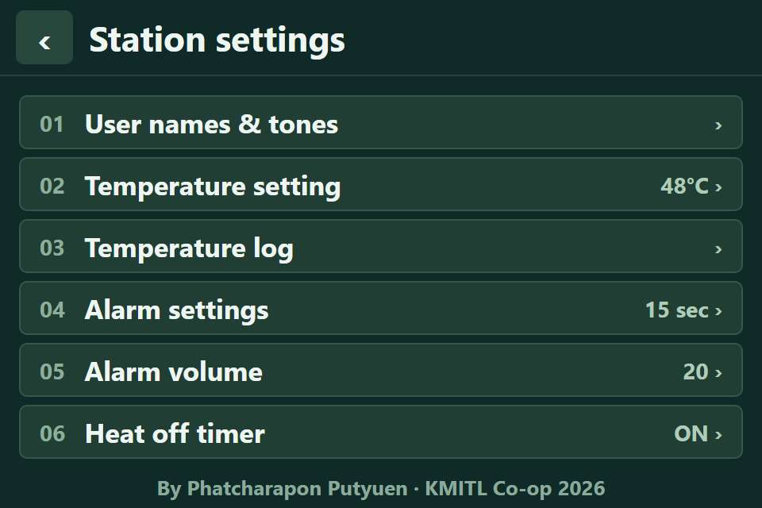<br>Station settings | 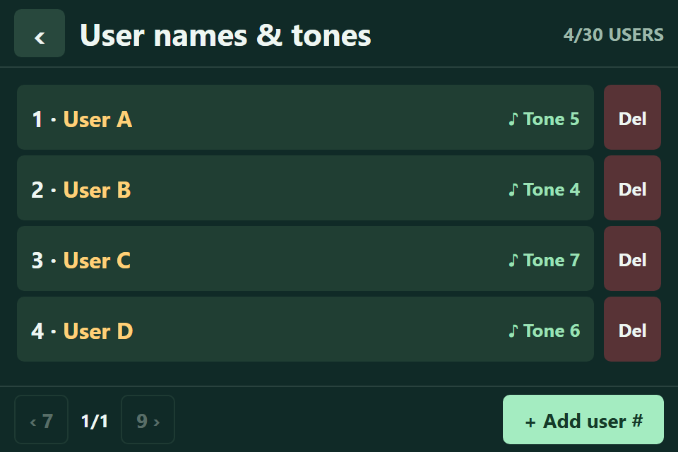<br>User names and tones (up to 30 users) |
| 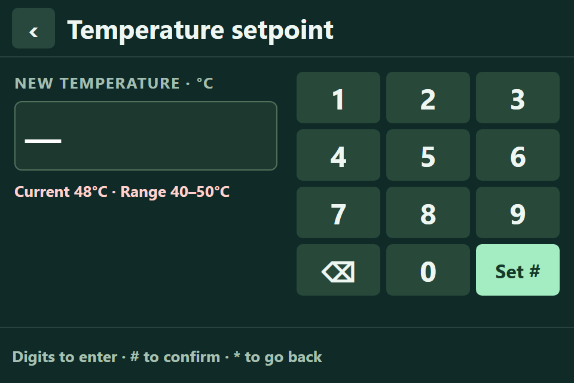<br>Temperature setpoint, 40–50 °C | 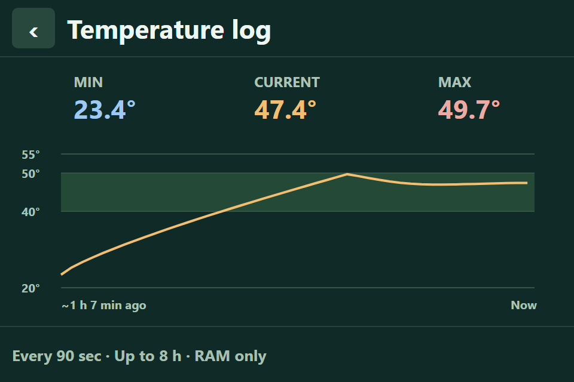<br>Temperature log, last 8 h |
| 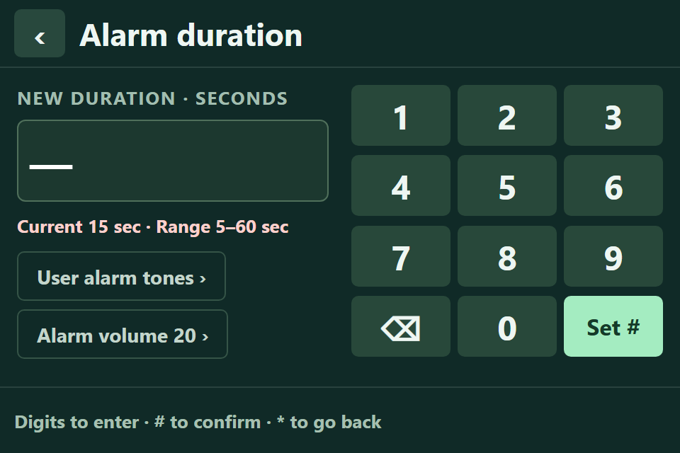<br>Alarm duration | 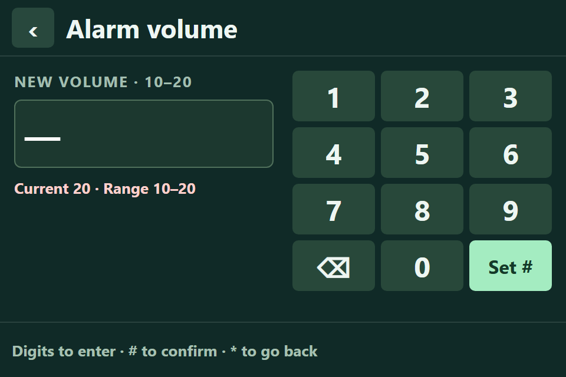<br>Alarm volume |
| 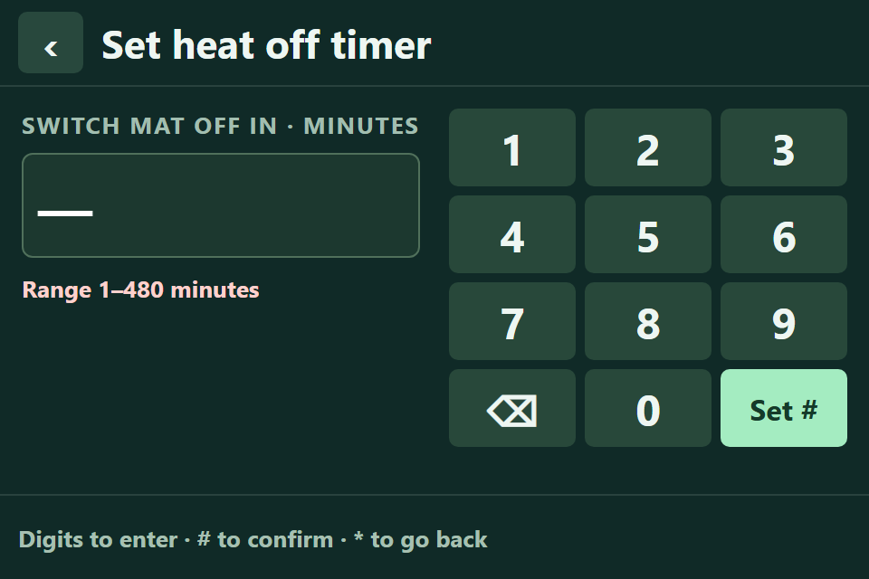<br>Heat-off timer | 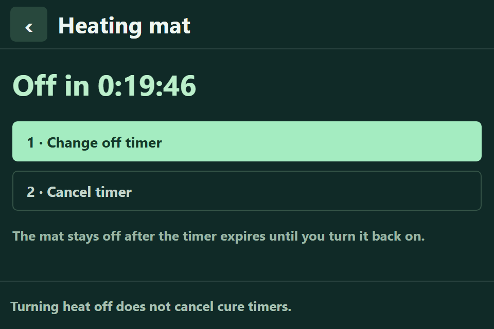<br>Heating mat with the off timer running |
| 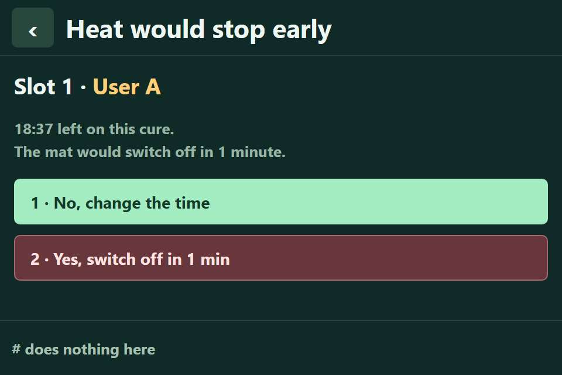<br>Warning: the heat would stop before a cure ends | 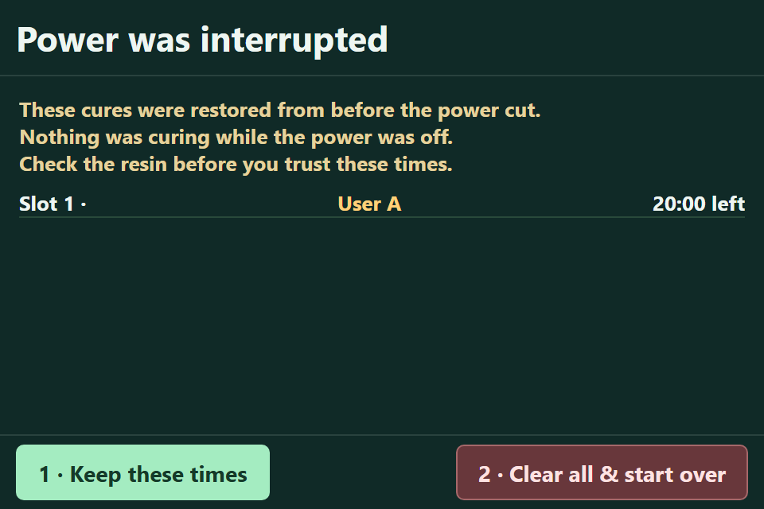<br>After a power cut: restored cures |

## Hardware

| Part | Used for |
|---|---|
| ESP32-WROOM-32 DevKitC | main controller |
| 4.0-inch 480×320 SPI display, ST7796S driver, FT6336U capacitive touch (I²C) | screen and touch |
| 4×3 matrix keypad | buttons beside the screen |
| DS18B20 waterproof probe on a terminal board | box air temperature |
| SSR-25DA solid-state relay, driven through an NPN transistor | switches the 220 V heating mat |
| 220 V silicone heating mat with its own dial thermostat, fused | heater |
| DFPlayer Mini + speaker, micro-SD card | alarm tones |
| 5 V USB supply | powers the controller side |
| ESP32-C3 Super Mini + push button + 400 mAh LiPo + TP4056 board | wireless alarm-stop button (separate board) |

## Pin map (main board)

Every pin below was checked on the built station.

| Function | ESP32 GPIO | Notes |
|---|---|---|
| Display MOSI / MISO / SCLK | 23 / 19 / 18 | SPI |
| Display CS / DC / RST | 5 / 2 / 13 | GPIO 2 is a strapping pin (see Flashing) |
| Display backlight | — | wired to 3.3 V, always on |
| Touch SDA / SCL | 15 / 22 | FT6336U, I²C |
| Touch INT | 36 | input-only pin |
| Touch RST | — | wired to 3.3 V |
| DS18B20 data | 4 | 4.7 kΩ pull-up to 3.3 V (on the probe's terminal board) |
| SSR driver | 16 | active HIGH, held LOW at boot |
| DFPlayer TX → ESP32 RX | 35 | |
| ESP32 TX → DFPlayer RX | 17 | through a 1 kΩ resistor |
| Keypad rows R1–R4 | 14, 32, 33, 26 | |
| Keypad columns C1–C3 | 27, 21, 25 | |

## What the firmware does

- **Temperature control.** On/off control with ±0.5 °C hysteresis around the setpoint. The setpoint is
  limited to 40–50 °C in code, not only in the menu. If the probe stops reading, the heater is switched
  off and the screen shows `--.-`. An over-temperature warning comes on above 55 °C.
- **Six cure slots.** Each slot has a user, a cure time and, optionally, the part being cured. The slots
  count down once a second. A finished cure shows a green "Cure complete" overlay and plays that user's
  tone until it is stopped.
- **Users and tones.** Users are added and deleted on the screen. Each one picks one of 10 tones.
- **Power-loss recovery.** Users, settings and running slots are saved to flash (Preferences) every
  30 s. After a power cut, the cures that come back show a "power was interrupted" warning first.
- **Inputs.** Touch, the 4×3 keypad (digits pick list rows, `#` confirms, `*` goes back) and the wireless
  button. Any of them stops an alarm.
- **Wireless alarm stop.** The ESP32-C3 button sleeps until pressed, sends one ESP-NOW broadcast, then
  sleeps again. The station stops the oldest sounding alarm.
- **Screen.** A dark green theme with the company wordmark in the header. The screen blanks after a set
  time and any touch wakes it.

## Source layout

| Path | What it is |
|---|---|
| `src/station.*` | data model: six slots, users, setpoint, settings |
| `src/heater.*` | SSR on/off control with hysteresis |
| `src/temp_sensor.*` | DS18B20 reading over 1-Wire |
| `src/persist.*` | saving and restoring state in flash |
| `src/sound.*` | DFPlayer control, tones, volume, module restart |
| `src/matrix_keypad.*` | 4×3 keypad scanning |
| `src/ctp_touch.*` | FT6336U capacitive touch over I²C |
| `src/remote_stop.*`, `src/remote_stop_protocol.h` | ESP-NOW receiver for the alarm-stop button |
| `src/ui_fuji.*` | the screen UI used on the station (capacitive panel) |
| `src/ui.*`, `src/display.*` | an older dark UI for a resistive-touch panel, kept for reference |
| `src/ui_logo.*` | the header wordmark as a bitmap (generated by `tools/make_ui_logo.py`) |
| `src/ui_fonts.*` | **not included**, see "Fonts" below |
| `tools/` | font and logo generators and Python serial loggers (`temp_log.py`, `press_log.py`, `resume_log.py`) |
| `User_Setup_epoxy.h` | the settings to copy into TFT_eSPI's own `User_Setup.h` |

### Sketches in `examples/`

| Sketch | Purpose |
|---|---|
| `Test_ui_fuji` | **the station firmware**: full UI, heating, alarms, keypad, wireless stop |
| `Test_ui` | the same for the older resistive panel |
| `Test_espnow_button` | the wireless button (ESP32-C3, built on its own, see its header) |
| `Test_ctp_scan`, `Test_ctp_touch` | touch bring-up |
| `Test_keypad`, `Test_keypad_discover` | keypad check, and finding the rows/columns of an unknown keypad |
| `Test_temp_control`, `Test_temp_log`, `Test_ssr_toggle` | heating and temperature logging |
| `Test_sound` | DFPlayer and speaker check |
| `Test_full_load` | 30-minute test with every load on at once (mat unplugged) |
| `Test_stuck_on` | holds the SSR on with no control, to test the mat's own dial cut-off (supervised test only) |
| `Test_radio_power`, `Test_c3_led`, `Test_c3_button_led` | radio supply and ESP32-C3 checks |

## Building

1. **Arduino ESP32 core** (`esp32:esp32`) and these libraries from the Library Manager:
   TFT_eSPI 2.5.43, OneWire 2.3.8, DallasTemperature 4.0.6, Keypad 3.1.1, DFRobotDFPlayerMini 1.0.6.
   Preferences, Wire, WiFi and ESP-NOW come with the core.
2. **TFT_eSPI setup.** TFT_eSPI reads its pins only from its own `User_Setup.h`. Copy the settings from
   `User_Setup_epoxy.h` into it: ST7796 driver, the pins above, `SPI_FREQUENCY 27000000`, inversion off
   for the capacitive panel, no `TFT_BL`.
3. **Fonts.** Generate `src/ui_fonts.cpp` and `src/ui_fonts.h` (see below).
4. **Install the library.** Clone this repository into your Arduino `libraries` folder, or pass it with
   `--library`.
5. Compile and upload in one command (`arduino-cli upload` does not accept `--library`):

   ```
   arduino-cli compile --fqbn "esp32:esp32:esp32:UploadSpeed=115200" \
     --library "<path to this repo>" --upload -p COM3 examples/Test_ui_fuji
   ```

### Flashing notes for this board

- **Hold the BOOT button** while esptool prints its `Connecting...` dots. Auto-reset does not work,
  because the display holds GPIO 2, a strapping pin.
- **Use 115200 baud.** Faster upload speeds corrupt the transfer on this build.
- Close the Serial Monitor first. A port held open by another program makes the upload fail.

### Fonts

The UI uses Segoe UI, built into the firmware as anti-aliased TFT_eSPI fonts. Segoe UI is a Microsoft
font, and its licence does not allow it to be shared inside another product, so the generated files are
not in this repository. Make them on any Windows PC (needs Python and Pillow):

```
python tools/make_ui_fonts.py
```

The script reads the fonts from `C:\Windows\Fonts` and writes `src/ui_fonts.cpp` and `src/ui_fonts.h`.
To get files that can be shared, change `FONT_FILES` in the script to Selawik (a free Microsoft font
under the SIL Open Font License) and run it again. Nothing else changes.

### SD card for the DFPlayer

Format the card FAT32 and copy the tones onto it as `0001.mp3` … `0010.mp3`, **in that order**, one
file at a time. The DFPlayer numbers tracks by the order they were copied, not by their names.

### Wireless button

`Test_espnow_button` is built for the ESP32-C3 Super Mini and does not use this library:

```
arduino-cli compile --fqbn "esp32:esp32:nologo_esp32c3_super_mini:CDCOnBoot=cdc" --upload -p COMx examples/Test_espnow_button
```

The button goes between GPIO 3 and GND, with a 10 kΩ pull-up to 3.3 V. The battery feeds the board's
5 V pin through a TP4056 protection board and a slide switch. The header of the sketch has the full
wiring. `remote_stop_protocol.h` is copied in both places on purpose. If the station stops answering a
button, check that the two copies are still identical.

## Safety

This controls a 220 V heater. The heating mat keeps its own dial thermostat and a fuse as backstops.
The SSR pin is set LOW as the first step of `setup()`. Do not run `Test_stuck_on` unattended. Work on the mains side only with the plug pulled.

## Licence

The code is under the MIT License (see `LICENSE`). The FUJIFILM wordmark in `src/ui_logo.*` is a trademark
of FUJIFILM Corporation and is not covered by this licence.

## Author

Phatcharapon Putyuen, co-op student, Biomedical Engineering, King Mongkut's Institute of
Technology Ladkrabang (KMITL), 2026.
